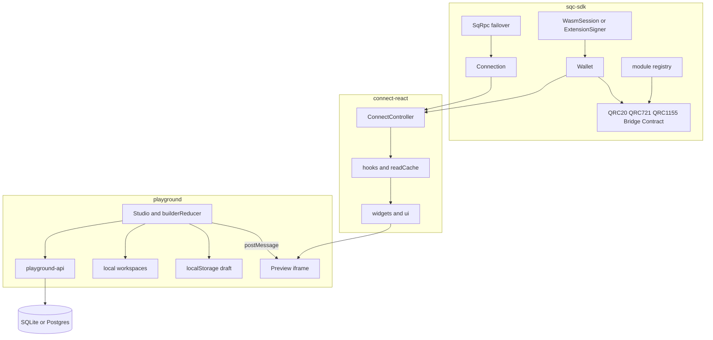
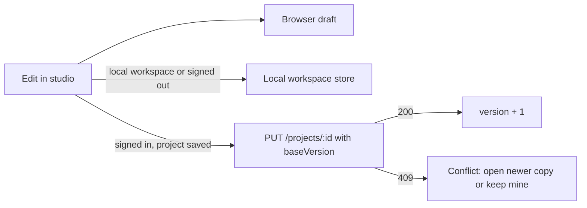

# Playground and SDK architecture

How the dApp Playground, the Playground API, `@splendor/connect-react` and `@splendor/sqc-sdk`
fit together, what a review in October 2026 found in each layer, and the roadmap that follows
from it. Paths are relative to the repository root.

## Layers

| Layer | Entry points | Role |
| --- | --- | --- |
| `sdk/sqc-sdk` | `src/public-api.ts`, `src/core/connection.ts`, `src/rpc.ts`, `src/splendor-wallet.ts`, `src/tokens/*`, `src/session.ts` | RPC with URL failover, ML-DSA signing (WASM or extension), routed module clients, typed `BridgeError` codes. |
| `sdk/connect-react` | `src/core/controller.ts`, `src/react/provider.tsx`, `src/react/hooks/*`, `src/widgets/*`, `src/ui/*` | Connection state machine, React hooks over the SDK, drop-in widgets, testing kit, widget manifest. |
| `packages/dapp-spec` | `src/types.ts`, `src/validate.ts`, `src/migrate.ts`, `src/codegen.ts`, `blocks/*` | The `DappSpec` format, validation, migrations, templates and kits, Vite/Next codegen. |
| `apps/playground` | `src/builder/BuilderPage.tsx`, `src/builder/Studio.tsx`, `src/builder/state.ts`, `src/preview/*` | Visual studio, isolated preview iframe, gallery, learn recipes, workspaces. |
| `apps/playground-api` | `src/app.ts`, `src/store/sql.ts` | ML-DSA sign-in, sessions, workspaces, projects, share links, admin catalog flags, releases, audit. |

## Data flows

### Studio and preview

The studio owns a `builderReducer` state (`apps/playground/src/builder/state.ts`) with undo
history. On every change it posts a `render` message (`apps/playground/src/preview/protocol.ts`)
to the preview iframe, which runs on an opaque origin in production; a selection change alone
posts a smaller `select` message. The frame is its own entry (`apps/playground/preview.html`),
so it loads the renderer and mock wallet but not the playground's pages and router. It answers
with `rects` (measured nodes and drop targets), `hover`, `select`, `navigate`, `drop`, `calls`
(the mock wallet log) and `invalid`.

- Each frame document gets a random token in its URL fragment and must echo it; messages
  without it are dropped. If the frame loads a second document (it navigated away), the parent
  replaces the frame. Inside the frame, web links open a new window and forms never submit.
- Rects are sanitized and capped on the parent side (`sanitizeRects`). Hover and rects go to a
  small store read only by the canvas overlay (`studio/canvasStore.ts`), so they do not
  re-render the studio; the palette, inspector and layers panels are memoized.
- A contract-function drop is checked like typed input (`parseContractDrop` in `studio/abi.ts`).
- Below 1100 px the rail panels and the inspector open as drawers over the canvas; tapping a
  component adds it, and the selection's move handle follows a finger (pointer events).

### Saving

- Edits are written to the browser draft (`apps/playground/src/builder/storage.ts`) 800 ms
  after the last one, and right away on leave, unmount, New and Import, with the project id
  and the cloud version they were based on. A refused write (storage full or disabled) shows
  "Not saved" in the top bar and makes the browser ask before leaving.
- Projects in a browser (`local-…`) workspace are also kept in the local workspace store
  (`apps/playground/src/workspaces/local.ts`). An account workspace id is never used as a
  browser key; signed out, such a link asks to sign in. Signed in, the home page lists browser
  projects and saves the chosen ones to the account, removing each browser copy only once the
  account has it.
- Cloud projects autosave 1.5 s after the last edit, only after an actual edit, and retry
  network and server errors (2 s, 5 s, 15 s). The save carries `baseVersion`; the API rejects
  a stale one with `409 CONFLICT` instead of overwriting a newer copy from another tab. A rename
  from the home page is checked the same way.
- A draft that is saved nowhere else, or has edits its account project does not have yet, is
  stashed before anything replaces it (a template, the picker, New, Import, Remix, opening
  another project, a restore), and the studio offers to restore it. Restoring swaps the stash
  with the current draft. A draft nobody edited (`edited: false`) is never stashed, so an
  untouched template cannot push real work out of the one-slot stash.
- An editor that has unmounted never writes the draft slot again (a save that finishes late
  would otherwise overwrite the next editor's draft). Restoring a revision refuses while edits
  are not in the account yet.
- Every saved spec is a revision (the newest 20 rows). Deletes go to a 30-day trash, at most 200
  projects per owner; a workspace goes with its projects and comes back with them, within the
  100-project limit.

### Sign-in

The playground asks `POST /auth/nonce`, the wallet signs the challenge with ML-DSA, and
`POST /auth/verify` checks it with the SDK's `verifySignIn` and sets an HttpOnly session
cookie (`__Host-` when Secure). Only a hash of the session id is stored. State-changing
requests need JSON and an allowed `Origin`.

### Wallet and transactions in apps

`SplendorConnectProvider` builds a `ConnectController`. Hooks read through
`useReadConnection()` (no wallet needed) and send through `useTxAction` / `useDeployAction`,
which add a single-flight lock, the pending-transaction list and balance invalidation. Widgets
compose hooks with review, fee and confirmation UI.

## Findings

### Playground UI and user experience

| Finding | Where | Status |
| --- | --- | --- |
| A stale draft was pushed to the cloud about 1.5 s after opening, even without edits, and saves had no version check. | `builder/BuilderPage.tsx` | Fixed |
| One draft slot per browser, silently replaced by templates, New, Import and Remix; the URL dropped `?project=`. | `builder/BuilderPage.tsx`, `builder/storage.ts`, `builder/SharedPage.tsx` | Fixed |
| Save status was only visible in the Project tab. | `builder/Studio.tsx` | Fixed (top-bar chip) |
| Renaming the dApp did not rename the header: `initBuilder` copied the name into `nav.brand`. | `builder/state.ts` | Fixed |
| The Finish setup count included issues the list hides. | `builder/Studio.tsx` | Fixed |
| Jumping to an issue failed while the Inspector was on Style or Actions. | `studio/Inspector.tsx` | Fixed |
| The export panel pointed to issues "under the preview". | `builder/ExportPanel.tsx` | Fixed |
| Projects could not be renamed or duplicated from the home page. | `home/HomePage.tsx` | Fixed |
| Below 1100 px the studio collapses to one column; drag and drop needs a mouse. | `styles.css`, `studio/StudioShell.tsx`, `studio/CanvasOverlay.tsx` | Fixed (drawers, tap to add, pointer move handle) |
| Every preview hover re-renders the whole studio (no memoized panels). | `builder/Studio.tsx`, `studio/canvasStore.ts` | Fixed (overlay store, memoized panels) |
| Each preview frame loads the main bundle; every selection change resends the spec. | `preview.html`, `preview/main.tsx`, `preview/PreviewFrame.tsx` | Fixed (own entry, `select` message). The pages were already lazy-loaded. |
| `window.confirm` for destructive actions and mainnet live mode. | `components/ConfirmDialog.tsx` | Fixed (focus-trapped dialog, Cancel first; stacked dialogs handle their own Escape) |
| Unsaved edits to an account project were dropped by New, Import and Remix. | `builder/storage.ts` | Fixed (stashed with their version) |
| Draft writes failed silently when storage was full; every keystroke wrote the draft. | `builder/storage.ts`, `builder/BuilderPage.tsx` | Fixed (reported, debounced, flushed on leave) |
| A missing `?project=` silently opened an unrelated draft. | `builder/BuilderPage.tsx` | Fixed (error, picker) |
| Signed out, an account workspace id became a browser key; browser projects could not move to the account. | `builder/BuilderPage.tsx`, `home/LocalUpload.tsx` | Fixed |
| Playground sign-in only existed inside Share and Admin; home flashed "No workspaces yet" before the session loaded. | `auth/AccountMenu.tsx`, `home/HomePage.tsx` | Fixed |
| No copy button for share links; no timeout when the preview never starts. | `builder/ProjectPanel.tsx`, `preview/PreviewFrame.tsx` | Fixed |
| The export dialog pointed to setup issues behind itself. | `builder/ExportPanel.tsx` | Fixed (lists them, jumps to the first) |
| Layer rows put buttons inside tree items. | `studio/LayersPanel.tsx` | Fixed (focusable tree item, actions beside it, Ctrl+D) |
| No copy and paste of blocks. | `builder/BuilderPage.tsx`, `builder/state.ts` | Fixed (Ctrl/Cmd+C, Ctrl/Cmd+V, across projects in one tab) |
| No search or trash on the home page; no version history in the studio. | `home/HomePage.tsx`, `home/Trash.tsx`, `builder/ProjectPanel.tsx` | Fixed |

### Playground security

| Finding | Where | Status |
| --- | --- | --- |
| The mock preview kept trusting the iframe after it navigated, and accepted contract drops after a type check only. | `preview/PreviewFrame.tsx`, `preview/PreviewRuntime.tsx`, `studio/abi.ts` | Fixed (frame token, reload on navigation, links in a new window, checked drops) |
| `ALLOW_TEST_LOGIN` was allowed on a public host when `NODE_ENV=test`. | `playground-api/src/config.ts` | Fixed (loopback `HOST` only) |
| Gallery code used `allowUnpinnedWasm` and an unversioned unpkg embed script. | `gallery/codeExport.ts` | Fixed (pinned digests or the plugin's, versioned URLs) |
| Release run links were rendered from upstream data without a check. | `admin/AdminPage.tsx` | Fixed (https GitHub run links only) |
| `vite preview` allowed CORS on every path, wider than the deploy configs. | `vite.config.ts` | Fixed (`/assets/*` only) |
| Mainnet live confirmation lasting across projects. | `builder/BuilderPage.tsx` | Not an issue: the editor remounts per opened, imported or remixed spec, so the yes does not carry over. |

### Playground API

| Finding | Where | Status |
| --- | --- | --- |
| Project saves had no optimistic concurrency. | `src/app.ts`, `src/store/sql.ts` | Fixed (`version`, `baseVersion`, 409) |
| CORS did not allow `PATCH`, which workspace rename uses. | `src/app.ts` | Fixed |
| Workspace `name` / `workspaceId` had no length or pattern; `GET /projects` had no query schema. | `src/app.ts` | Fixed |
| Unknown routes returned Fastify's default body; 4xx errors had no `requestId`. | `src/app.ts` | Fixed |
| No way to rename, move or duplicate a project without resending the spec. | `src/app.ts` | Fixed (`PATCH /projects/:id`, `POST /projects/:id/duplicate`) |
| No project history, no soft delete. | `src/store/sql.ts` | Fixed (20 revisions per project, restore as a new version; 30-day trash) |
| `app.ts` is one 500+ line function with every route. | `src/routes/*` | Fixed (auth, workspaces, projects, share, admin, deployments) |
| Audit log skips project, workspace, share and logout events. | `src/routes/*` | Fixed (autosaves once per project per 10 minutes) |
| No pagination, search or sort on project lists. | `src/store/sql.ts` | Fixed (`q`, `sort`, keyset `cursor`; index on `(owner, updated_at)`) |
| Deleting a workspace unlinked its projects in two statements, while the home page said they were deleted. | `src/store/sql.ts` | Fixed (one transaction, to the trash together) |
| `PATCH /projects/:id` without `baseVersion` could write an older spec over a newer save. | `src/routes/projects.ts` | Fixed (checked against the version it read) |
| Share links had no expiry or view count. | `src/routes/share.ts` | Fixed (`expiresInDays`, `shareViews`) |
| Every deployment insert failure was reported as "Subdomain is taken". | `src/routes/deployments.ts` | Fixed (unique violation 409, otherwise 500). Hosting stays off and has no worker. |
| Rate limits and caches are per process; no Postgres migration lock; no metrics or OpenAPI. | `src/app.ts`, `src/store/sql.ts` | Later |

### Second review (of the pass above)

| Finding | Where | Status |
| --- | --- | --- |
| An untouched draft could push real work out of the one-slot stash; the picker after a failed link, Restore, and opening another project replaced drafts without stashing them. | `builder/BuilderPage.tsx`, `builder/storage.ts` | Fixed (`edited` flag, stash on every replacement, Restore swaps) |
| A save finishing after the editor unmounted wrote a stale draft; restoring a revision could drop edits the account did not have; a local-workspace project kept being written after it was saved to the account. | `builder/BuilderPage.tsx` | Fixed |
| A reload right after typing could miss the debounced draft write. | `builder/BuilderPage.tsx` | Fixed (flush compares the on-screen spec with the last write) |
| Below 1100 px, "Choose", "Open Contracts", "Go to the first one" and the tour targeted closed drawers. | `builder/Studio.tsx`, `studio/StudioShell.tsx` | Fixed |
| Contract functions with a display name ("Get count" for `get()`) could not be dropped onto the page. | `studio/abi.ts` | Fixed (name and kind come from the spec's own contract) |
| The preview frame's reload budget reset on every `ready`; drafts were posted to a frame that had navigated; stale rects stayed after a reload; the notice shifted the overlay. | `preview/PreviewFrame.tsx` | Fixed (budget returns after 5 s on the preview, stop with a notice, rects cleared, notice laid over the frame) |
| SVG and image-map links were not captured in the frame; web links opened in a sandboxed window. | `preview/PreviewRuntime.tsx`, `preview/PreviewFrame.tsx` | Fixed (`allow-popups-to-escape-sandbox`, links use `noopener`) |
| Touch moves could leave the overlay stuck if the handle unmounted; shortcuts changed the page behind dialogs. | `studio/CanvasOverlay.tsx`, `builder/BuilderPage.tsx` | Fixed |
| Gallery pins did not name the version they belong to; release links accepted any host with a run-shaped path. | `gallery/codeExport.ts`, `admin/AdminPage.tsx`, API `releases.ts` | Fixed (exact install line, validated pins, `htmlHost`) |
| Restoring a workspace bypassed the 100-project limit. | API `routes/workspaces.ts`, `store/sql.ts` | Fixed (429) |
| Name-sorted pages could skip non-ASCII names; a bad cursor silently restarted at page 1. | API `store/sql.ts` | Fixed (cursor carries the database's own sort key and list kind; 400) |
| SQLite statements from other requests could run inside an open transaction. | API `store/index.ts` | Fixed (one queue for every statement) |
| Fewer than 20 revisions kept after moves; restore could leave a dangling workspace id; purge raced restore; trash grew without bound. | API `store/sql.ts` | Fixed (newest 20 rows, live-workspace check, row locks and cascade, 200-project trash cap with paging) |
| A failed audit write turned a created deployment into 500; HEAD counted as a share view; a broken Postgres client went back to the pool. | API | Fixed |
| The API suite only ever ran on SQLite. | `app.test.ts`, CI | Fixed (`TEST_DATABASE_URL`, per-test schemas, `playground-api-postgres` job) |

### connect-react widgets and hooks

| Finding | Where | Status |
| --- | --- | --- |
| Failed transactions and hook validation errors showed "Connection failed". | `src/core/controller.ts` | Fixed (transaction context) |
| Extension payloads with `INVALID_PARAMS` became `UNKNOWN`, and lost their hint. | `src/core/controller.ts` | Fixed |
| Hooks threw plain `Error`s for "not ready". | `src/react/hooks/*` | Fixed (`BridgeError` `NOT_CONNECTED`) |
| `useQRC20`, `useQRC1155`, `useBridge`, `useContract` had no `errorMessage`. | `src/react/hooks/*` | Fixed |
| `useQRC1155().refresh` does nothing. | `src/react/hooks/qrc1155.ts` | Deprecated |
| Polling kept running in hidden tabs. | `src/react/hooks/{core,qrc20,read,pending}.ts` | Fixed |
| Docs said QRC-721 has no hooks. | `README.md`, `docs/GUIDE.md` | Fixed |
| Hook results still differ (`confirmed`, `explorerUrl`, `WriteOpts` vs `params.fee`). | `src/react/hooks/*` | Next |
| No hook uses `subscribe()`; everything polls. | `src/react/hooks/*` | Next |
| `ui/` strings (modals, toasts, connect button) are not translatable. | `src/ui/*` | Next |
| No `system` theme, no mobile modal height cap, no toast stack limit. | `src/theme/*`, `src/ui/*` | Next |
| Missing widgets: activity, NFT gallery, receive with QR, fee selector, address book. | `src/widgets/*`, `src/manifest.ts` | Fixed except the fee selector (Phase 1 chain widgets) |
| `ValidatorsClient.list()` calls `GET /validators`, which the node does not serve. | `sqc-sdk/src/validators.ts` | `useValidators` uses the routed `validators.list` read; fix the client next |
| QRC-721 emits no events, so ownership cannot be read from logs. | `vm/qrc721.go` | Open (NFT panel scans an id range) |
| Explorer log JSON encodes topics, addresses and hashes as byte arrays and `data` as base64, unlike `ChainLog`'s string types. | `core/types/receipt.go`, `sqc-sdk/src/core/explorer-types.ts` | Parsed in `core/activity.ts`; align the type next |
| The controller is built on the deprecated `createSplendorClient` and `SqcProvider`. | `src/core/controller.ts` | Later (major) |

### sqc-sdk core

| Finding | Where | Status |
| --- | --- | --- |
| A hung primary RPC can take about 80 s before the next URL is tried. | `src/rpc.ts` | Next (total budget, circuit breaker) |
| `wasm_exec.js` is evaluated with `new Function`; check the CSP advice in the READMEs. | `src/wasm-loader.browser.ts` | Next |
| Ten ways to build a wallet or client, three read clients, EVM-era leftovers. | `src/public-api.ts` | Later (major) |
| `fromUnits` / `toUnits` read the opposite way from `parseUnits` / `formatUnits`. | `src/units.ts` | Later (aliases first) |
| `rpc.ts` pulls in the deprecated EVM derive module for `CHAIN_ID`. | `src/rpc.ts`, `src/derive.ts` | Next |

## Target architecture

- **One save model.** The browser draft is a cache of the open project, keyed by project and
  version; the cloud is the source of truth for signed-in projects, with versions and
  history. Conflicts are explicit, never silent.
- **Thin API modules.** `app.ts` becomes plugins (security, session) and route modules
  (auth, workspaces, projects, share, catalog, admin, deployments), with one error shape
  `{ error, code, requestId, issues? }` and an OpenAPI document generated from the schemas.
- **connect-react on `Connection`.** The controller exposes a `Connection` and a `Signer`;
  hooks bind module clients through `bindModules` instead of constructing them; connectors
  declare capabilities (`requiresWasm`) instead of being matched by id.
- **Event-driven reads.** A `useChainEvents` hook on `subscribe()` invalidates the shared read
  cache; polling is the fallback and pauses in hidden tabs.
- **One result shape for every transaction hook**: `status`, `hash`, `explorerUrl`,
  `confirmed`, `error`, `errorMessage`, `reset`, with a trailing `WriteOpts` on every write.

## Roadmap

### Now (done in this pass)

- Conflict-safe cloud saves with `version` / `baseVersion` and a conflict prompt; autosave only
  after edits; save status in the studio top bar.
- `?project=` kept in the URL; draft records its version; replaced drafts can be restored.
- Four studio bugs (header name, setup count, Inspector tab, export copy).
- API: CORS `PATCH`, stricter schemas, not-found handler and `requestId` on errors,
  `PATCH /projects/:id` and `POST /projects/:id/duplicate`, Rename and Duplicate on project
  cards (cloud and browser).
- connect-react: transaction-aware error copy, `INVALID_PARAMS` mapping, `BridgeError` from
  hooks, `errorMessage` on four more hooks, polling paused in hidden tabs, docs fixes.

### Done in the playground review pass

- Drafts: dirty account edits stashed, refused writes reported, writes debounced and flushed,
  a failed `?project=` reported, account workspace ids never used as browser keys, browser
  projects saved to the account on request, autosave retries, one create at a time.
- Security: preview frame token and reload on navigation, links in a new window, checked
  contract drops, loopback-only test login, pinned gallery snippets, release-link check,
  preview CORS on `/assets` only.
- Experience: header sign-in, focus-trapped confirmations, share link copy, preview start
  timeout, export setup list, layers tree semantics, block copy and paste, audit loading and
  empty states.
- Studio: drawers below 1100 px, tap to add, pointer move handle, hover and rects outside the
  studio state, memoized panels, `preview.html` entry, `select` message.
- API: revisions and restore, 30-day trash for projects and workspaces, search, sort and keyset
  pages, audit for project, workspace, share and logout events, route modules, share expiry and
  view counts, deployment error codes.
- Second review: the fixes in the table above, with tests for each scenario (API on SQLite and
  Postgres, unit, and Playwright on the production build), and a Postgres CI job.

### Done in Phase 1: chain-native widgets

- connect-react widgets, with manifest and embed entries: `nft-panel` (QRC-721 grid, send and
  owner-only mint), `bridge-claim` (status, burn lookup, opt-in operator claim), `validator-list`
  (active set, bond, admission lookup), `activity-feed` (QRC-20 / QRC-1155 transfer logs plus
  pending sends, optional `/idx/v1/logs` indexer), `receive` (QR code and `splendor:` payment
  link), `address-book` (per-network local contacts, offered as quick picks in transfer widgets),
  `token-balances`, and a `qr-code` part.
- Hooks `useValidators`, `useActivity` and `useAddressBook`; `useBridge` reads work before
  connecting; a dependency-free QR encoder (`widgets/parts/qr.ts`) checked against the ISO
  Reed-Solomon example and an independent decoder.
- dapp-spec blocks `nft721-gallery` and `x402-paywall` (402 requirements, `payX402`, retry with
  `X-Payment`, price cap; a labelled client-only demo without a resource URL), with validation
  for id ranges, https-or-localhost URLs and token lists.
- Playground: mock QRC-721 ownership, bridge, validators, Transfer logs with a moving head and
  x402 settlement; four Learn recipes; the "NFT membership" template; unit, preview and
  Playwright coverage.

### Phase 2: builder logic

- Shared variables in the spec, props bound to variables or contract reads, stored `onSuccess`
  / `onError` actions (navigate, toast, set a variable, refresh), wired `form-*` blocks and
  conditional visibility (spec v3 with a migration).

### Phase 3: builder UX

- Command palette, multi-select and group edits, asset library, per-page SEO and favicon,
  an accessibility checker in the issues panel, breakpoint overrides, shortcut help.

### Phase 4: publishing

- Hosted publishing: a worker that builds queued deployments (the route records them; nothing
  builds them yet), preview subdomains, generated `_headers` / `vercel.json` with a CSP, CI and
  smoke tests in exports, typed contract clients bound to the UI.

### Phase 5: AI and collaboration

- Spec generation from a prompt (checked by `validateSpec`), one-click fixes for issues,
  workspace members and roles, comments on nodes, an activity log.

### Next
- connect-react: `useChainEvents`, consistent hook results, translatable `ui/` strings,
  `system` theme and mobile polish.
- sqc-sdk: RPC total time budget and per-URL circuit breaker; CSP review for `wasm_exec.js`;
  move `CHAIN_ID` out of `derive.ts`.

### Later (major versions)

- Rebase connect-react on `Connection` and `createSession`; drop `SqcProvider`,
  `createSplendorClient`, `evmAddress` and the deprecated hook names.
- Prune the SDK's duplicate client constructors and EVM leftovers; rename the unit helpers
  (aliases ship in a minor first).
- New widgets: fee selector (the rest shipped in Phase 1); a staking flow once validator
  registration is open to the widgets.
- API: workspace members and roles, metrics, OpenAPI, Postgres migration lock, shared
  rate-limit store (the API stays a single instance until then).
- Studio: multi-select and a command palette.
