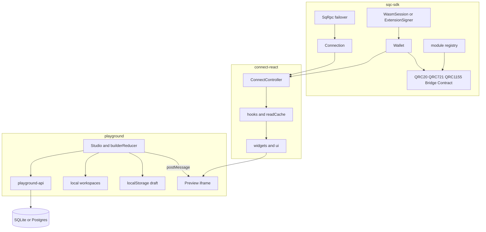
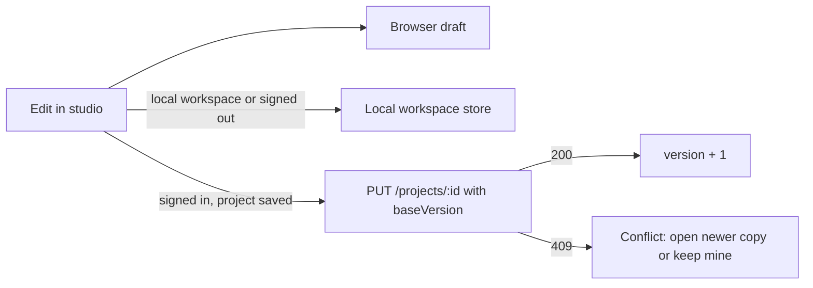

# Playground and SDK architecture

How the dApp Playground, the Playground API, `@splendor/connect-react` and `@splendor/sqc-sdk`
fit together, what a review in October 2026 found in each layer, and the roadmap that follows
from it. Paths are relative to the repository root.

## Layers

| Layer | Entry points | Role |
| --- | --- | --- |
| `sdk/sqc-sdk` | `src/public-api.ts`, `src/core/connection.ts`, `src/rpc.ts`, `src/splendor-wallet.ts`, `src/tokens/*`, `src/session.ts` | RPC with URL failover, ML-DSA signing (WASM or extension), routed module clients, typed `BridgeError` codes. |
| `sdk/connect-react` | `src/core/controller.ts`, `src/react/provider.tsx`, `src/react/hooks/*`, `src/widgets/*`, `src/ui/*` | Connection state machine, React hooks over the SDK, drop-in widgets, testing kit, widget manifest. |
| `packages/dapp-spec` | `src/types.ts`, `src/validate.ts`, `src/migrate.ts`, `src/codegen.ts`, `blocks/*` | The `DappSpec` format, validation, migrations, templates and kits, Vite/Next codegen. |
| `apps/playground` | `src/builder/BuilderPage.tsx`, `src/builder/Studio.tsx`, `src/builder/state.ts`, `src/preview/*` | Visual studio, isolated preview iframe, gallery, learn recipes, workspaces. |
| `apps/playground-api` | `src/app.ts`, `src/store/sql.ts` | ML-DSA sign-in, sessions, workspaces, projects, share links, admin catalog flags, releases, audit. |

## Data flows

### Studio and preview

The studio owns a `builderReducer` state (`apps/playground/src/builder/state.ts`) with undo
history. On every change it posts a `render` message (`apps/playground/src/preview/protocol.ts`)
to the preview iframe, which runs on an opaque origin in production. The frame answers with
`rects` (measured nodes and drop targets), `hover`, `select`, `navigate`, `drop`, `calls` (the
mock wallet log) and `invalid`. Rects are sanitized and capped on the parent side
(`sanitizeRects`) before the overlay uses them.

### Saving

- Every edit is written to the browser draft (`apps/playground/src/builder/storage.ts`), with
  the project id and the cloud version it was based on.
- Projects in a browser workspace, or created while signed out, are also kept in the local
  workspace store (`apps/playground/src/workspaces/local.ts`).
- Cloud projects autosave 1.5 s after the last edit, only after an actual edit. The save
  carries `baseVersion`; the API rejects a stale one with `409 CONFLICT` instead of
  overwriting a newer copy from another tab.
- A draft that is saved nowhere else is stashed before a template, New, Import or Remix
  replaces it, and the studio offers to restore it.

### Sign-in

The playground asks `POST /auth/nonce`, the wallet signs the challenge with ML-DSA, and
`POST /auth/verify` checks it with the SDK's `verifySignIn` and sets an HttpOnly session
cookie (`__Host-` when Secure). Only a hash of the session id is stored. State-changing
requests need JSON and an allowed `Origin`.

### Wallet and transactions in apps

`SplendorConnectProvider` builds a `ConnectController`. Hooks read through
`useReadConnection()` (no wallet needed) and send through `useTxAction` / `useDeployAction`,
which add a single-flight lock, the pending-transaction list and balance invalidation. Widgets
compose hooks with review, fee and confirmation UI.

## Findings

### Playground UI and user experience

| Finding | Where | Status |
| --- | --- | --- |
| A stale draft was pushed to the cloud about 1.5 s after opening, even without edits, and saves had no version check. | `builder/BuilderPage.tsx` | Fixed |
| One draft slot per browser, silently replaced by templates, New, Import and Remix; the URL dropped `?project=`. | `builder/BuilderPage.tsx`, `builder/storage.ts`, `builder/SharedPage.tsx` | Fixed |
| Save status was only visible in the Project tab. | `builder/Studio.tsx` | Fixed (top-bar chip) |
| Renaming the dApp did not rename the header: `initBuilder` copied the name into `nav.brand`. | `builder/state.ts` | Fixed |
| The Finish setup count included issues the list hides. | `builder/Studio.tsx` | Fixed |
| Jumping to an issue failed while the Inspector was on Style or Actions. | `studio/Inspector.tsx` | Fixed |
| The export panel pointed to issues "under the preview". | `builder/ExportPanel.tsx` | Fixed |
| Projects could not be renamed or duplicated from the home page. | `home/HomePage.tsx` | Fixed |
| Below 1100 px the studio collapses to one column; drag and drop needs a mouse. | `styles.css` | Next |
| Every preview hover re-renders the whole studio (no memoized panels). | `builder/Studio.tsx`, `preview/PreviewRuntime.tsx` | Next |
| Routes are not lazy-loaded; each preview frame loads the main bundle. | `App.tsx`, `vite.config.ts` | Next |
| `window.confirm` for destructive actions and mainnet live mode. | `home/HomePage.tsx`, `builder/BuilderPage.tsx` | Next (`ModalDialog`) |

### Playground API

| Finding | Where | Status |
| --- | --- | --- |
| Project saves had no optimistic concurrency. | `src/app.ts`, `src/store/sql.ts` | Fixed (`version`, `baseVersion`, 409) |
| CORS did not allow `PATCH`, which workspace rename uses. | `src/app.ts` | Fixed |
| Workspace `name` / `workspaceId` had no length or pattern; `GET /projects` had no query schema. | `src/app.ts` | Fixed |
| Unknown routes returned Fastify's default body; 4xx errors had no `requestId`. | `src/app.ts` | Fixed |
| No way to rename, move or duplicate a project without resending the spec. | `src/app.ts` | Fixed (`PATCH /projects/:id`, `POST /projects/:id/duplicate`) |
| No project history, no soft delete. | `src/store/sql.ts` | Next |
| `app.ts` is one 500+ line function with every route. | `src/app.ts` | Next (route modules) |
| Audit log skips project, workspace, share and logout events. | `src/app.ts` | Next |
| No pagination, search or sort on project lists. | `src/store/sql.ts` | Next |
| Rate limits and caches are per process; no Postgres migration lock; no metrics or OpenAPI. | `src/app.ts`, `src/store/sql.ts` | Later |

### connect-react widgets and hooks

| Finding | Where | Status |
| --- | --- | --- |
| Failed transactions and hook validation errors showed "Connection failed". | `src/core/controller.ts` | Fixed (transaction context) |
| Extension payloads with `INVALID_PARAMS` became `UNKNOWN`, and lost their hint. | `src/core/controller.ts` | Fixed |
| Hooks threw plain `Error`s for "not ready". | `src/react/hooks/*` | Fixed (`BridgeError` `NOT_CONNECTED`) |
| `useQRC20`, `useQRC1155`, `useBridge`, `useContract` had no `errorMessage`. | `src/react/hooks/*` | Fixed |
| `useQRC1155().refresh` does nothing. | `src/react/hooks/qrc1155.ts` | Deprecated |
| Polling kept running in hidden tabs. | `src/react/hooks/{core,qrc20,read,pending}.ts` | Fixed |
| Docs said QRC-721 has no hooks. | `README.md`, `docs/GUIDE.md` | Fixed |
| Hook results still differ (`confirmed`, `explorerUrl`, `WriteOpts` vs `params.fee`). | `src/react/hooks/*` | Next |
| No hook uses `subscribe()`; everything polls. | `src/react/hooks/*` | Next |
| `ui/` strings (modals, toasts, connect button) are not translatable. | `src/ui/*` | Next |
| No `system` theme, no mobile modal height cap, no toast stack limit. | `src/theme/*`, `src/ui/*` | Next |
| Missing widgets: activity, NFT gallery, receive with QR, fee selector, address book. | `src/widgets/*`, `src/manifest.ts` | Later |
| The controller is built on the deprecated `createSplendorClient` and `SqcProvider`. | `src/core/controller.ts` | Later (major) |

### sqc-sdk core

| Finding | Where | Status |
| --- | --- | --- |
| A hung primary RPC can take about 80 s before the next URL is tried. | `src/rpc.ts` | Next (total budget, circuit breaker) |
| `wasm_exec.js` is evaluated with `new Function`; check the CSP advice in the READMEs. | `src/wasm-loader.browser.ts` | Next |
| Ten ways to build a wallet or client, three read clients, EVM-era leftovers. | `src/public-api.ts` | Later (major) |
| `fromUnits` / `toUnits` read the opposite way from `parseUnits` / `formatUnits`. | `src/units.ts` | Later (aliases first) |
| `rpc.ts` pulls in the deprecated EVM derive module for `CHAIN_ID`. | `src/rpc.ts`, `src/derive.ts` | Next |

## Target architecture

- **One save model.** The browser draft is a cache of the open project, keyed by project and
  version; the cloud is the source of truth for signed-in projects, with versions and
  history. Conflicts are explicit, never silent.
- **Thin API modules.** `app.ts` becomes plugins (security, session) and route modules
  (auth, workspaces, projects, share, catalog, admin, deployments), with one error shape
  `{ error, code, requestId, issues? }` and an OpenAPI document generated from the schemas.
- **connect-react on `Connection`.** The controller exposes a `Connection` and a `Signer`;
  hooks bind module clients through `bindModules` instead of constructing them; connectors
  declare capabilities (`requiresWasm`) instead of being matched by id.
- **Event-driven reads.** A `useChainEvents` hook on `subscribe()` invalidates the shared read
  cache; polling is the fallback and pauses in hidden tabs.
- **One result shape for every transaction hook**: `status`, `hash`, `explorerUrl`,
  `confirmed`, `error`, `errorMessage`, `reset`, with a trailing `WriteOpts` on every write.

## Roadmap

### Now (done in this pass)

- Conflict-safe cloud saves with `version` / `baseVersion` and a conflict prompt; autosave only
  after edits; save status in the studio top bar.
- `?project=` kept in the URL; draft records its version; replaced drafts can be restored.
- Four studio bugs (header name, setup count, Inspector tab, export copy).
- API: CORS `PATCH`, stricter schemas, not-found handler and `requestId` on errors,
  `PATCH /projects/:id` and `POST /projects/:id/duplicate`, Rename and Duplicate on project
  cards (cloud and browser).
- connect-react: transaction-aware error copy, `INVALID_PARAMS` mapping, `BridgeError` from
  hooks, `errorMessage` on four more hooks, polling paused in hidden tabs, docs fixes.

### Next

- Project version history and restore; soft delete with a trash and 30-day purge.
- Split `app.ts` into route modules; audit project, workspace, share and logout events.
- Pagination, search and sort on project lists.
- Studio usable below 1100 px, touch drag and drop, memoized panels for preview hover, lazy
  routes and a lighter preview bundle.
- connect-react: `useChainEvents`, consistent hook results, translatable `ui/` strings,
  `system` theme and mobile polish.
- sqc-sdk: RPC total time budget and per-URL circuit breaker; CSP review for `wasm_exec.js`;
  move `CHAIN_ID` out of `derive.ts`.

### Later (major versions)

- Rebase connect-react on `Connection` and `createSession`; drop `SqcProvider`,
  `createSplendorClient`, `evmAddress` and the deprecated hook names.
- Prune the SDK's duplicate client constructors and EVM leftovers; rename the unit helpers
  (aliases ship in a minor first).
- New widgets: activity feed, NFT gallery, receive with QR, fee selector, address book,
  token balances.
- API: workspace members and roles, share-link expiry and view counts, metrics, OpenAPI,
  Postgres migration lock, shared rate-limit store.
