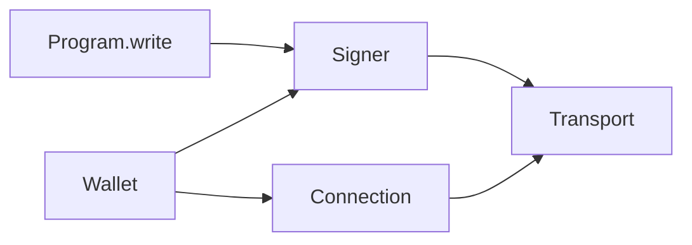

# Splendor SQC SDK Architecture (`@splendor/sqc-sdk` v2)

Unified JavaScript/TypeScript SDK for Splendor Quantum Chain — wallet, native modules, and dApp integration.

## Recommended entry paths

| Who | Use |
|-----|-----|
| Headless / agents / Node | `createSession()` (bound modules) |
| Browser UI | `@splendor/connect-react` (`ConnectKit` / `SplendorConnectProvider`) |
| Full UI demo | [`examples/web-dapp`](../examples/web-dapp) |
| Legacy imports | `@splendor/pq-bridge` (deprecated shim) |

Canonical recipes: **`createSession`** (headless) + **ConnectKit** (UI). Prefer `Connection` for reads; `SqcProvider` is a thin deprecated alias.

Deprecated (still exported): `connectSplendor`, `createSplendorClient`, `useSplendorPQ`, default `SplendorPQBridge` name (`Wallet` preferred).

Prefer `createSession` / `modules.bind(connection, wallet)` so writes omit the wallet argument. Unbound `modules.qrc20(connection, addr).transfer(wallet, …)` remains for advanced use.

## Package layout

```
@splendor/sqc-sdk
├── .                    # createSession(), modules, deployQRC20(), Wallet
├── /core                # Connection, Transport, Program, Signer, module-registry
├── /wallet              # Keypair, connectors, connect()
├── /tokens              # QRC20 + QRC1155
├── /tokens/qrc20
├── /tokens/qrc1155
├── /contracts           # bytecode deploy/call
├── /defi                # DEX + Exchange
├── /bridge              # on-chain bridge_v1 (≠ pq-bridge shim)
├── /x402                # payment protocol helpers
├── /addresses           # MODULE_ROUTER, qrc20/1155/exchange/dex/bridge addresses
├── /browser
└── /react               # useSplendorPQ (deprecated; prefer connect-react)
```

## Layers

1. **Transport (chain IO)** — owns balance, nonce, module reads, submit, confirmation, x402 verify/settle, subscribe. `RpcTransport` wraps `SqRpc` privately; `MockTransport` scripts the same surface for tests (no hidden live RPC).
2. **Connection** — thin façade over Transport. Do not use a parallel `SqRpc` for production paths. `connection.rpc` is deprecated and only works when the transport is `RpcTransport`.
3. **Signer** — Program write type: `getAddress`, `sendModuleCall`, `callContract`, plus optional capabilities (`signPermit`, `signOrder`, `signCancel`, `signIncrementNonce`, `signBridgeClaim`, `signVerifyInstruction`, `signVerifyAttestation`, `payX402`). `Wallet` implements the full surface; `MockSigner` is submit-only.
4. **Program** — typed native module clients. Writes take `Signer`; deploy actions use `isDeployAction()` overrides (e.g. DEX `deploy_pool`). Declarative `writeMethods()` drive `withSigner` binding.
5. **Module registry** — `registerModule` / `defineModule` / `listModules`. Built-ins register once from `modules.ts`; session bind tables come from the registry.
6. **Recipes** — `createSession()`, `modules.*`, `deployQRC20()`, etc.



## Module registry

```ts
import { createSession, modules, registerModule, defineModule } from '@splendor/sqc-sdk';

const s = await createSession({ network: 'local', mode: 'seed', seed });
await s.token(tokenAddr).transfer(recipient, '10');

// Addon: implement Program → register once → export subpath (no Session bind edits)
registerModule(
  defineModule({
    id: 'myModule',
    create: (connection, address) => new MyProgram(connection, address),
  }),
);
```

## Built vs next (SDK modules)

| Module | SDK Program | Notes |
|--------|-------------|--------|
| QRC-20 | Built | deploy, transfer, approve, permit |
| QRC-1155 | Built | deploy, mint, transfer, burn |
| DEX | Built | deploy_pool, add_liquidity, swap, pool_info |
| Exchange | Built | deploy, conditions, match, cancel, signing, position_id, order_hash |
| Bridge (`bridge_v1`) | Built | deploy, claim, operators |
| Verify / SQVL (`verify_v1`) | Built | deploy, register (dual-signed instruction), attest, finalize, spend, operators, pause; `proof` / `instance` reads; `/verify/*` doors on `SqRpc` |
| Bytecode contracts | Built | QSol ABI call + deployBytecode |
| QSol compile-in-SDK | Not built | use monorepo `sqc-solc` offline |

## Native modules

Writes: `signer.sendModuleCall({ module, action, params })` → `TxCall` to `MODULE_ROUTER_ADDRESS` (via Connection → Transport).

Reads: `connection.moduleCall(envelope)` → Transport `POST /call` with the same JSON envelope.

Programs inject the instance address under the correct key (`token`, `collection`, `pool`, `exchange`, `bridge`, `verify`).

## Connectors

- **Headless** (`Connector`): `connect(connection) → Wallet` — used by `connect()`.
- **Unlock** (`WalletUnlockConnector`): `unlock({ wallet, connection }) → DeriveInfo` — canonical for UI.
- **connect-react** wraps unlock with UI metadata (`name`, `icon`, `keyOrigin`).

## SQDP-1

Wallet derivation, fees, confirmation, and WASM pinning follow [SQDP-1.md](SQDP-1.md).

## Adding a new Program

1. Implement `src/<area>/<name>.ts` extending `Program` (override `instanceParamKey` / `isDeployAction` if needed).
2. Add address helper in `src/addresses/index.ts` matching Go `vm` derivation.
3. Call `registerModule(defineModule({ id, create }))` (built-ins do this from `modules.ts`).
4. Export from a package subpath + `public-api.ts` if first-party.
5. Add functional tests under `src/__tests__/`.

No hand-editing of Session bind tables is required for registry-backed modules.
